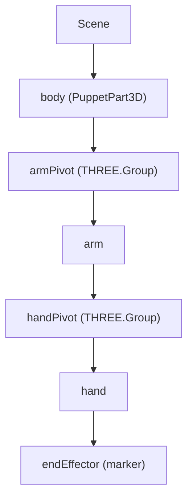

# Digital Wayang Kulit: architecture

A technical write-up of the digital wayang kulit interface (NUS, Aug 2024 – Feb 2025),
from the code, the git history and the project docs (milestones, the weekly log, the IK
notes). Back to the [README](README.md).

**Contents:**
1. [Goals and milestones](#1-goals-and-milestones)
2. [Stack](#2-stack)
3. [The puppet as a scene graph](#3-the-puppet-as-a-scene-graph)
4. [The puppet schema](#4-the-puppet-schema)
5. [Loading parts](#5-loading-parts)
6. [Input and the eight degrees of freedom](#6-input-and-the-eight-degrees-of-freedom)
7. [Inverse kinematics](#7-inverse-kinematics)
8. [Simulation](#8-simulation)
9. [Decisions and trade-offs](#9-decisions-and-trade-offs)
10. [Timeline](#10-timeline)
11. [Limits and next steps](#11-limits-and-next-steps)

## 1. Goals and milestones

Make a puppet show possible without physical puppets: a digital puppet in the browser,
to be driven later by a machine-vision model that reads the puppeteer's sticks. The work
was split into three concerns: the interface, 3D modelling, and computer vision. This
repo is the interface.

| Milestone | Achieved when |
|---|---|
| 2 | All joints defined and positioned, each with its axis of rotation, and the model holds together when parts rotate |
| 3 | Arms move, the body rotates and translates, keyboard controls respond, and scripted input can drive it |
| 4 | The puppet turns around its vertical axis to show its back, staying flat, and can be viewed from any angle |
| 4+ | Inverse kinematics: the hand's end point traces a 2D target, and the arm and hand angles follow |

## 2. Stack

| | |
|---|---|
| Rendering | Three.js 0.167 (`WebGLRenderer`, high precision, max anisotropy), three-stdlib loaders |
| Build | Vite 5.4 (ES modules), deployed on GitHub Pages |
| Animation | GSAP 3.12, `requestAnimationFrame` loop |
| Assets | OBJ and MTL per part, GLB variants; a Python script to shift OBJ vertices |

## 3. The puppet as a scene graph



Each joint is a `THREE.Group`, placed at the joint's pivot position, with the part inside
it offset so the group's origin is the joint. Rotating `armPivot` swings the arm and
carries the hand with it. Moving or turning the body carries everything. This gives
correct relative motion with no manual transform maths. `SHOW_HELPERS` draws the pivots
for calibration.

## 4. The puppet schema

Every puppet is one JSON file. The loaders, the event handlers and the reset logic all
read from it, so a new puppet needs no code changes:

```json
"hand": {
  "path": "./assets/puppet_01/models/hand/hand.obj",
  "material": "./assets/puppet_01/models/hand/hand.mtl",
  "scale": [0.08, 0.08, 0.07],
  "position": [-0.025, 0.01, 0.055],
  "rotation": [-1.7, -1.7, -0.2],
  "pivotPosition": [0, 0, 0.11],
  "endEffectorPosition": [-0.00, 0, 0.11]
},
"limits": { "x": { "min": -10, "max": 10 }, "y": { "min": -5, "max": 5 }, "z": { "min": -50, "max": 35 } }
```

`body`, `arm` and `hand` each carry their model, material, scale, position and rotation,
plus the pivot for each joint. The hand also carries the end-effector position the IK
solver aims for. `limits` bound the body's movement. Two puppets are configured
(`puppet_01`, `puppet_02`), and `IS_MANUAL_PUPPET_INPUT` asks which one to load.

## 5. Loading parts

`PuppetPart3D` (OBJ and MTL) and `PuppetPartGLB` (glTF binary) share one interface:
`loadModel(callback)`, `addToScene` and `addToParent`, `setPosition` and `setRotation`,
and `move` and `rotate`. `init(puppetName)` fetches the JSON, loads the parts
asynchronously, builds the pivot hierarchy, stores the initial state for resets, and
attaches the event handlers once everything is ready.

## 6. Input and the eight degrees of freedom

| Part | Degrees of freedom | Keys |
|---|---|---|
| Body | translate x, y, z | arrows, `,` `.` |
| Body | rotate about 3 axes | `W` `S`, `A` `D`, `Q` `E` |
| Arm | rotate about its joint | `H` `L` |
| Hand | rotate about its joint | `J` `K` |
| All | reset | `X` |

`keydown` and `keyup` keep a set of active keys, and the animation loop applies every
active key each frame (`handleKeyMovements`). So keys combine: the puppet can move
diagonally while turning, in all nine directions. Translations are clamped to the
puppet's `limits`, and `X` clears the keys and restores the stored initial state. The arm
and hand keys apply when the cursor isn't driving the IK.

## 7. Inverse kinematics

The arm is a two-link chain: shoulder to elbow, then elbow to the hand's end point.

1. Map the mouse to a 3D point in the puppet's plane (`getNormalizedMousePosition`,
   `convertTo3DCoordinates`).
2. **Clamp to reach:** if the target is farther than arm + hand, scale it back onto the
   circle of maximum reach (`getMaxPossibleMousePosition`).
3. Measure the three distances: shoulder → target, arm length, hand length.
4. **Cosine rule** for the interior angles, clamped to [-1, 1] against floating-point
   error:

```js
export function calculateAngleWithCosineRule(leftA, rightB, oppositeC) {
    const numerator = Math.pow(leftA, 2) + Math.pow(rightB, 2) - Math.pow(oppositeC, 2);
    const denominator = 2 * leftA * rightB;
    let cosAngleFraction = Math.min(1, Math.max(-1, numerator / denominator));
    return Math.acos(cosAngleFraction);
}
```

5. Add the direction from the shoulder to the target (`atan2`), and subtract the body's
   own rotation. Then set `armPivot.rotation.y` and `handPivot.rotation.y`.
6. Repeat on every mouse move. The current angles are shown on screen.

## 8. Simulation

`tests/Simulation.js` dispatches synthetic `KeyboardEvent`s on timers: press, hold,
release. These form scripted sequences, including a prolonged one, that exercise every
degree of freedom. `IS_SIMULATION_ACTIVE` starts the app with a sequence running. This
mimics the commands a machine-vision model will send, so the interface can be tested
without a camera.

## 9. Decisions and trade-offs

| Decision | Alternatives | Why | Cost |
|---|---|---|---|
| Separate parts joined by pivot groups | One model rigged in Blender or SolidWorks | Parts can be swapped per puppet and moved independently; the joints live in data | Each part's alignment must be calibrated |
| No physics engine | Cannon.js (prototyped, with gravity) | Cannon.js centres on collision physics, which made the parts overlap and fight the IK | No gravity sway on the arm |
| A small custom IK solver | A forked 3D IK arm (studied as a reference) | Two links have a closed form (the cosine rule), so it's simple and exact | Only two links, in one plane |
| A JSON schema per puppet | Hard-coded positions (archived as `mainWithHardcode.js`) | New puppets need no code | The schema must be documented ([assets/README.md](src/assets/README.md)) |
| OBJ/MTL and GLB loaders | One format | Works with whatever the modelling tool exports | Two classes to maintain |
| Forking workflow and PRs | Committing straight to main | Each change is reviewed into the shared repo | Fork syncing |

## 10. Timeline

From the weekly log, the milestones and the git history.

| When | Milestone |
|---|---|
| Aug 2024 (weeks 1–2) | Stack set up (Node, npm, Three.js); repository and forking workflow; a lit orbiting cube; OOP structure; the first JSON schema for puppet parts |
| Sep 2024 (weeks 3–4) | Split into interface, 3D modelling and computer vision; Cannon.js prototype; an IK arm studied; vertex-plane extraction of the body |
| Oct 2024 | Milestone 1 demo (18 Oct); static physics and joint movement; simulation runner; milestones 2–4 (22–24 Oct); inverse kinematics, including with the body turned (25–31 Oct) |
| Nov 2024 | Final changes and deployment to GitHub Pages (6 Nov) |
| Dec 2024 – Feb 2025 | Documentation and README updates (last on 21 Feb 2025) |

## 11. Limits and next steps

- **Machine vision:** the interface is ready to be driven by a model that detects the
  stick end points (a separate repository). Connecting the two is the next step.
- A suspected WebGL bug sometimes drops body parts on first load; a reload fixes it.
- The puppet's stick shows on both sides, because the source image covers only one side.
- The 3D models can be refined further. Fine details of the leather puppet don't fully
  survive extrusion.
