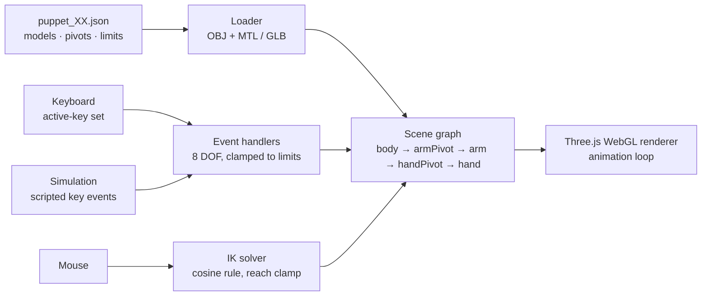

<div align="center">

# Digital Wayang Kulit

**A shadow-puppet show in the browser, with the puppet's arm following your hand.**<br>
An interactive prototype of [wayang kulit](https://en.wikipedia.org/wiki/Wayang_kulit), the Javanese and Malay shadow-puppet
tradition: a 3D puppet built with [Three.js](https://threejs.org), with eight degrees of freedom and an inverse-kinematics arm, made at NUS.

**[▶ Live demo](https://sp4ce-cowboy.github.io/nus-wayang-kulit/)**

[](https://developer.mozilla.org/en-US/docs/Web/JavaScript)
[](https://threejs.org/docs/)
[](https://vite.dev/guide/)
[](https://gsap.com/docs/v3/)
[](https://developer.mozilla.org/en-US/docs/Web/API/WebGL_API)
[](https://docs.blender.org/manual/en/latest/)
[](https://sp4ce-cowboy.github.io/nus-wayang-kulit/)
[-0085CA?logo=acm&logoColor=white)](#publication)


[](https://wakatime.com)

</div>

> [!NOTE]
> This consolidated README page was added by [Claude](https://docs.anthropic.com/en/docs/claude-code)
> using my [agentic-repo-analysis](https://github.com/sp4ce-cowboy/agentic-workflows) skill, from the
> project's code, git history and documentation. The original README, the team's full user and
> developer guide, is in **[DOCUMENTATION.md](DOCUMENTATION.md)**. The technical write-up is in
> **[ARCHITECTURE.md](ARCHITECTURE.md)**.

<p align="center">
  
</p>

## At a glance

| | |
|---|---|
| **What** | A browser-based digital wayang kulit: a jointed 3D puppet (body, arm, hand) that can be moved, turned and posed in real time, with the arm solved by inverse kinematics |
| **Where** | National University of Singapore, Centre for Computational Social Science and Humanities |
| **When** | Aug 2024 – Feb 2025 |
| **My role** | Software engineer: the interface code end to end (Three.js scene and pivot hierarchy, the JSON puppet schema and loaders, the 8-DOF input system, inverse kinematics, simulation, deployment) and, together with the team, the 3D models |
| **Team** | Project director [Miguel Escobar Varela](https://orcid.org/0000-0001-8396-1664); advisor [Ganesh Neelakanta Iyer](https://www.comp.nus.edu.sg/cs/people/gni); software engineers [C Mahidharah Rajendran](https://github.com/Mahidharah) and [Rubesh Suresh](https://github.com/sp4ce-cowboy); machine vision by [Manav Kamlesh Chouhan](https://github.com/manavchouhan115) |
| **Research** | A paper is in preparation for the ACM Journal on Computing and Cultural Heritage: see [Publication](#publication) |
| **Status** | Interface complete and live; a machine-vision model to drive the puppet from real sticks is the next step |

## What it does

- **Eight degrees of freedom.** The body translates in 3 axes and rotates in 3, and the arm
  and the hand each rotate about their joint. All of it is on the keyboard, with keys that
  work at the same time.
- **Inverse kinematics.** The hand follows the mouse cursor. A two-link solver works out the
  arm and hand angles with the cosine rule, and clamps the target to the arm's reach.
- **Flat, like the real thing.** Turning the body reveals the back of the puppet, which
  stays thin and flat through the turn, like a leather puppet.
- **Any puppet, no code changes.** Each puppet is a JSON file: models, materials, scale,
  pivot positions, the end effector and movement limits. New puppets load from the file
  alone.
- **Simulation.** Scripted key sequences drive the puppet the way the machine-vision model
  will, for testing without a camera.
- **Control panel.** Flags switch the simulation, manual puppet selection, and the pivot
  helpers used for calibration.

## How it works



The puppet is a hierarchy of `THREE.Group` pivots. Rotating a pivot moves everything below
it, so the arm carries the hand and the body carries both. More in [ARCHITECTURE.md](ARCHITECTURE.md).

## Publication

> **Tangible interfaces for intangible cultural heritage**<br>
> Miguel Escobar Varela, C Mahidharah Rajendran, Rubesh Suresh, Manav Kamlesh Chouhan, Ganesh Neelakanta Iyer<br>
> *In preparation for the [ACM Journal on Computing and Cultural Heritage (JOCCH)](https://dl.acm.org/journal/jocch).* The project was funded by an NUS Seed Grant.

The paper presents this system as a case study in using tangible interfaces to represent
intangible cultural heritage. The excerpts below are from the working draft and may change.

**Abstract (draft).** *"This paper presents a novel approach to interacting with digitized
cultural objects in ways that preserve some of their physical properties. As a case study, we
use wayang kulit puppets to demonstrate the potential of tangible interfaces for accurately
representing intangible cultural heritage. We address the challenge of accessing Indonesian
cultural heritage artifacts housed in overseas museums by developing a system that recreates
the embodied experience of puppet manipulation through digital means. Our work demonstrates how
computer vision technologies can bridge the gap between digital preservation and traditional
puppet manipulation practices."*

**The problem.** *"Wayang kulit, the traditional shadow puppet theater of Java, Indonesia,
represents a complex form of cultural heritage that encompasses both tangible artifacts (the
puppets themselves) and intangible practices (manipulation techniques and performance
traditions)."* Many historical puppets now sit in overseas museums, far from their cultural
context. Digitisation keeps their image, but it *"fail[s] to capture the embodied knowledge
embedded in traditional puppet manipulation."* A dalang (puppet master) learns each puppet's
weight, movement and character by handling it. Conventional digital preservation reduces
puppets to two-dimensional images, and that tactile knowledge is lost.

**The system.** Three parts:

| Component | What it does | Where |
|---|---|---|
| Machine vision | A model fine-tuned to detect and track the two wooden control rods in real time, so physical manipulation maps to digital movement | Separate repository |
| Interactive display | The 3D puppet: driven by keyboard and mouse today, and by the rods' positions once connected | This repository |
| API | Connects the vision model to the display | In development |

**Authors**

| Author | Role in the project | Links |
|---|---|---|
| Miguel Escobar Varela, Centre for Computational Social Science and Humanities, NUS | Conceptualisation and direction | [ORCID](https://orcid.org/0000-0001-8396-1664) · [NUS profile](https://discovery.nus.edu.sg/6387-miguel-escobar-varela) · [GitHub](https://github.com/villaorlado) |
| C Mahidharah Rajendran, School of Computing, NUS | 3D model and user interface | [GitHub](https://github.com/Mahidharah) |
| Rubesh Suresh, College of Design and Engineering, NUS | 3D model and user interface | [GitHub](https://github.com/sp4ce-cowboy) |
| Manav Kamlesh Chouhan, School of Computing, NUS | Machine vision model | [GitHub](https://github.com/manavchouhan115) |
| Ganesh Neelakanta Iyer, School of Computing, NUS | Advice on the project's development | [NUS profile](https://www.comp.nus.edu.sg/cs/people/gni) · [Google Scholar](https://scholar.google.com/citations?user=W_BDu8oAAAAJ) |

For updates on the paper, contact Prof. Miguel Escobar Varela ([NUS profile](https://discovery.nus.edu.sg/6387-miguel-escobar-varela), m.escobar@nus.edu.sg).

## Skills shown

| Skill | Where it shows | Docs |
|---|---|---|
| **3D graphics on the web**<br> | Scene, lights, camera, renderer and animation loop: [`main.js`](https://github.com/sp4ce-cowboy/nus-wayang-kulit/blob/7be6ad25921de924c9ddddfc21979f39225b28c5/src/main.js#L101-L154) | [Three.js docs](https://threejs.org/docs/) |
| **Inverse kinematics** | A two-link solver using the cosine rule, with a reach clamp: [`InverseKinematics.js`](https://github.com/sp4ce-cowboy/nus-wayang-kulit/blob/7be6ad25921de924c9ddddfc21979f39225b28c5/src/common/InverseKinematics.js#L10-L54), [`getMaxPossibleMousePosition`](https://github.com/sp4ce-cowboy/nus-wayang-kulit/blob/7be6ad25921de924c9ddddfc21979f39225b28c5/src/common/EventHandlers.js#L303-L332) | [Two-link IK](https://en.wikipedia.org/wiki/Inverse_kinematics) |
| **Scene graphs & transforms** | A pivot hierarchy built from the JSON schema: [`init`](https://github.com/sp4ce-cowboy/nus-wayang-kulit/blob/7be6ad25921de924c9ddddfc21979f39225b28c5/src/main.js#L22-L99) | [Object3D](https://threejs.org/docs/#api/en/core/Object3D) |
| **Object-oriented JavaScript** | Interchangeable puppet-part classes for OBJ/MTL and GLB: [`PuppetPart3D`](https://github.com/sp4ce-cowboy/nus-wayang-kulit/blob/7be6ad25921de924c9ddddfc21979f39225b28c5/src/models/PuppetPart3D.js), [`PuppetPartGLB`](https://github.com/sp4ce-cowboy/nus-wayang-kulit/blob/7be6ad25921de924c9ddddfc21979f39225b28c5/src/models/PuppetPartGLB.js) | [Classes](https://developer.mozilla.org/en-US/docs/Web/JavaScript/Reference/Classes) |
| **Input handling** | Concurrent keys through an active-key set, clamped to the puppet's limits: [`EventHandlers.js`](https://github.com/sp4ce-cowboy/nus-wayang-kulit/blob/7be6ad25921de924c9ddddfc21979f39225b28c5/src/common/EventHandlers.js#L34-L203) | [KeyboardEvent](https://developer.mozilla.org/en-US/docs/Web/API/KeyboardEvent) |
| **Data-driven design** | Each puppet defined in JSON (models, pivots, end effector, limits): [`puppet_01.json`](https://github.com/sp4ce-cowboy/nus-wayang-kulit/blob/7be6ad25921de924c9ddddfc21979f39225b28c5/src/assets/puppet_01/puppet_01.json) | — |
| **Test automation** | Simulated key-event sequences: [`Simulation.js`](https://github.com/sp4ce-cowboy/nus-wayang-kulit/blob/7be6ad25921de924c9ddddfc21979f39225b28c5/tests/Simulation.js) | — |
| **3D modelling** | Puppet parts as OBJ/MTL and GLB, and a Python script to adjust OBJ files: [`assets/`](src/assets) | [Blender manual](https://docs.blender.org/manual/en/latest/) |
| **Team workflow**<br> | A forking workflow with feature branches and 16 merged pull requests; milestones and a weekly log in [docs/](docs) | — |
| **Deployment**<br> | Built with Vite and deployed to [GitHub Pages](https://sp4ce-cowboy.github.io/nus-wayang-kulit/) by a GitHub Actions workflow ([`deploy-pages.yml`](.github/workflows/deploy-pages.yml)) | [Vite: static deploy](https://vite.dev/guide/static-deploy) |

## By the numbers

| | |
|---|---|
| Period | 15 Aug 2024 – 21 Feb 2025 |
| Commits | 116 (16 merged pull requests, 11 branches) |
| Code | about 1,600 lines of JavaScript; 680 lines of docs |
| Puppets | 2 configured puppets, each with body, arm and hand models |

## Getting started

```sh
cd src
npm install
npm run dev
```

Controls, the control panel and how to calibrate a new puppet are in [DOCUMENTATION.md](DOCUMENTATION.md).

## On my resume

- Built a browser-based digital wayang kulit for NUS's Centre for Computational Social Science and Humanities: a jointed 3D shadow puppet in Three.js/WebGL with 8 degrees of freedom, concurrent keyboard control and a cursor-driven arm, deployed on GitHub Pages. A paper on it is in preparation for ACM JOCCH.
- Implemented closed-form two-link inverse kinematics (the cosine rule, with reach clamping and compensation for the body's rotation) so the puppet's hand tracks the cursor in real time.
- Designed a data-driven puppet schema (JSON models, pivots, end effectors, limits) and interchangeable OBJ/GLB part loaders, so new puppets load with no code changes. Added scripted input simulation to stand in for the planned machine-vision controller.
- Set up continuous deployment with GitHub Actions to build the Vite app, bundle its runtime 3D assets and publish it on GitHub Pages. Ran the 6-month project through a forking workflow with 16 reviewed pull requests.
